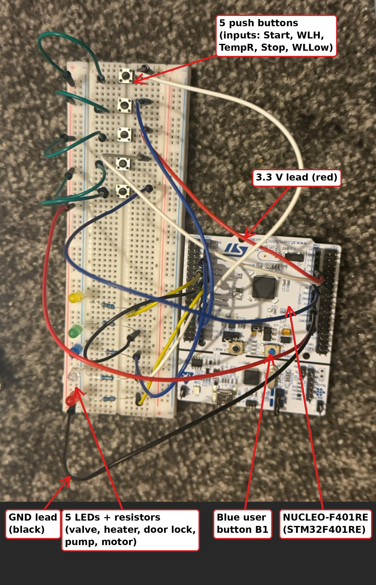
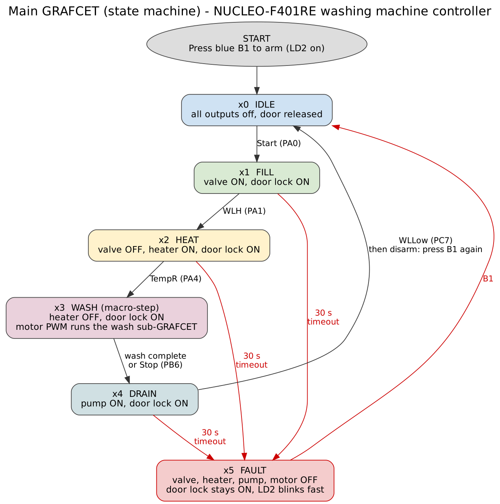
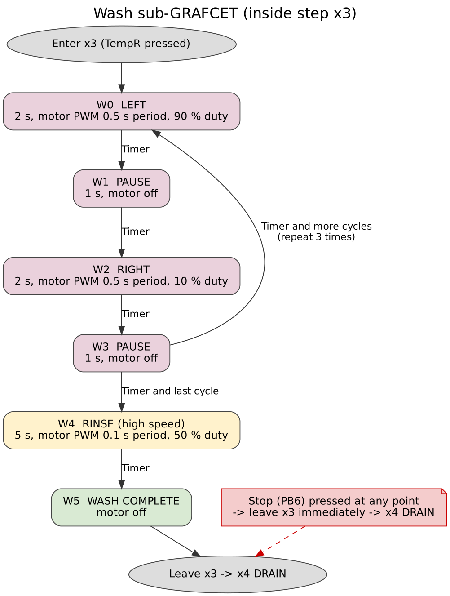

# STM32 Washing Machine Controller

Embedded system project using the **NUCLEO-F401RE** (STM32F401RE) board.

## 📌 Project Overview

This system simulates a reliable washing-machine controller with:

- Arming with the blue user button (B1)
- Fill → Heat → Wash → Drain sequence
- Automatic wash cycle (left / pause / right / pause, repeated, then high-speed rinse)
- Stop button that can end the wash at any point
- Timeout supervision with a Fault state
- Real-time status messages over the serial port

The user interacts with push buttons, and the system state is shown through LEDs
(valve, heater, door lock, pump, motor) and the on-board LD2.

## ⚙️ System Design

The controller is a **GRAFCET** (sequential function chart) implemented with set/reset equations.
It is fully interrupt driven and sleeps between events:

- Button presses are captured by EXTI interrupts and recorded as events
- A one-shot timer (TIM3) times the wash steps and the fault timeouts
- The main loop runs the GRAFCET once per request, then enters SLEEP mode (`WFI`)
- Outputs are a pure function of the active step

### Key Design Aspects

- Edge-detected, debounced button inputs (EXTI, 50 ms debounce)
- Main GRAFCET with steps x0 Idle, x1 Fill, x2 Heat, x3 Wash, x4 Drain, x5 Fault
- Wash macro-step with its own sub-GRAFCET (W0–W5)
- One-shot TIM3 interval timer; TIM2 PWM drives the motor LED
- 30 s supervision of Fill, Heat and Drain, with a Fault step
- 2 s independent watchdog, and a safe-state `Error_Handler` (all outputs off)
- UART status output on the ST-LINK virtual COM port

## 🔧 Hardware Mapping

| Component | Pin | Type |
|---|---|---|
| B1 blue button (arm / clear fault) | PC13 | EXTI13, falling edge |
| Start button | PA0 | EXTI0, rising edge, pull-down |
| WLH – water level high | PA1 | EXTI1, rising edge, pull-down |
| TempR – temperature reached | PA4 | EXTI4, rising edge, pull-down |
| WLLow – water level low | PC7 | EXTI7, rising edge, pull-down |
| Stop button | PB6 | EXTI6, rising edge, pull-down |
| Valve LED | PA8 | Output |
| Heater LED | PA10 | Output |
| Door lock LED | PB4 | Output |
| Pump LED | PB5 | Output |
| Motor LED | PB10 | TIM2_CH3 PWM |
| LD2 (on board) | PA5 | Steady = armed, fast blink = fault |

## 🖼️ System Overview



*Annotated photo of the NUCLEO-F401RE and breadboard. The original photo is `board.jpg`.*

The NUCLEO-F401RE (right) is wired to a breadboard (left) carrying:

- **5 push buttons** (top of the breadboard): Start, WLH, TempR, WLLow and Stop. One side of each
  button goes to 3.3 V (red lead) and the other side goes to its input pin on the Nucleo
  (white, blue and grey leads). The internal pull-down resistor keeps the pin at 0 V until the
  button is pressed.
- **5 LEDs** (bottom of the breadboard), each with a series resistor: valve, heater, door lock,
  pump and motor. The LED cathodes are tied to GND (black lead) and each anode goes to an
  output pin through its resistor.
- **Blue user button B1** and **green LED LD2** are built onto the Nucleo board itself.
- The Nucleo is powered and programmed through the ST-LINK USB cable.

## 🔘 Buttons and LEDs

### Inputs (push buttons)

| Button | Pin | Meaning | Effect |
|---|---|---|---|
| **B1** (blue, on board) | PC13 | Arm / clear fault | Arms the controller (LD2 on). After a fault, returns to idle |
| **Start** | PA0 | Start the cycle | Idle → Fill |
| **WLH** | PA1 | Water level high (drum full) | Fill → Heat |
| **TempR** | PA4 | Temperature reached | Heat → Wash |
| **Stop** | PB6 | Stop / end of wash | Wash → Drain (any time during the wash) |
| **WLLow** | PC7 | Water level low (drum empty) | Drain → Idle |

The WLH, TempR and WLLow buttons stand in for sensors: pressing one simulates the sensor
reporting that condition.

### Outputs (LEDs)

| LED | Pin | On during |
|---|---|---|
| **Valve** | PA8 | Fill |
| **Heater** | PA10 | Heat |
| **Door lock** | PB4 | Fill, Heat, Wash, Drain and Fault |
| **Pump** | PB5 | Drain |
| **Motor** (PWM) | PB10 | Wash only (see below) |
| **LD2** (on board) | PA5 | Steady = armed, fast blink = fault |

### Motor LED patterns (PWM)

| Phase | Period | Duty | Looks like |
|---|---|---|---|
| Left wash | 0.5 s | 90 % | Mostly on |
| Right wash | 0.5 s | 10 % | Short flash |
| Pause | – | 0 % | Off |
| Rinse (high speed) | 0.1 s | 50 % | Fast flicker |

## 🔁 State Machine Flow

### Main GRAFCET



B1 must be pressed first to arm the controller. When the controller returns to Idle it disarms,
so B1 has to be pressed again before the next cycle.

### Wash sub-GRAFCET (inside x3)



The left / pause / right / pause loop runs 3 times (`WASH_CYCLE_COUNT`), then the rinse. Pressing
**Stop** at any point leaves the wash and goes straight to Drain.

## 📁 Project Structure

```
stm32-washing-machine-controller/
├── main.c                 controller source code
├── README.md              this file
├── board.jpg              original photo of the board and breadboard
├── board_annotated.jpg    annotated photo (System Overview)
├── grafcet_main.png       main GRAFCET flowchart
└── grafcet_wash.png       wash sub-GRAFCET flowchart
```

The main logic is implemented in a single file: `main.c`

Replace only `main.c` in your STM32CubeIDE project (`Core/Src/main.c`). Keep
`stm32f4xx_it.c` and the MSP files generated by CubeMX.

## 🕹️ How to Operate

1. Optional: open a serial terminal on the ST-LINK COM port (115200, 8N1).
2. Press **B1** – LD2 turns on (controller armed). Process buttons are ignored before this.
3. Press **Start** – valve and door lock on (Fill).
4. Press **WLH** – valve off, heater on (Heat).
5. Press **TempR** – heater off, the wash starts (Wash).
6. The wash runs by itself: left 2 s, pause 1 s, right 2 s, pause 1 s, repeated 3 times,
   then high speed for 5 s (about 23 s in total). **Stop** ends the wash at any point.
7. The pump turns on and the door stays locked (Drain). Press **WLLow** – everything off, LD2 off.
8. Press **B1** to arm again.

### Fault handling

If WLH, TempR or WLLow is not pressed within 30 s of its step, the controller enters the Fault step:
valve, heater, pump and motor switch off, the door lock stays on, and LD2 blinks fast.
Press **B1** to return to idle (everything off), then **B1** again to arm.

## ⚙️ Setup & Build Instructions

1. Open **STM32CubeIDE** and import or create a project for the **NUCLEO-F401RE**.
2. Configure the pins as in the Hardware Mapping table (or use the CubeMX project provided).
3. Replace `Core/Src/main.c` with the `main.c` from this repository.
4. Choose the **Debug** configuration and click **Build** to verify compilation.
5. Connect the board over USB (ST-LINK) and click **Run** or **Debug**.
6. Press **F8** (or Resume) to run the program.

## 🧩 Peripheral Configuration (CubeMX)

`main.c` initialises all peripherals itself, so the settings below only need to match when you
create the project in STM32CubeIDE / CubeMX. In **Project Manager → Code Generator**, untick
"Generate peripheral initialization as a pair of .c/.h files" so the generated code does not clash
with the `MX_..._Init()` functions in `main.c`.

### Clock

| Setting | Value |
|---|---|
| Clock source | HSI 16 MHz |
| PLL (M / N / P / Q) | 16 / 336 / 4 / 7 |
| SYSCLK / HCLK | 84 MHz |
| APB1 (÷2) / APB2 (÷1) | 42 MHz / 84 MHz (APB1 timers run at 84 MHz) |
| Flash latency | 2 wait states |
| Voltage scale | Scale 2 |

### GPIO

| Pin | Mode | Pull | Speed | Use |
|---|---|---|---|---|
| PC13 | External interrupt, falling edge | No pull (board pull-up) | – | B1 blue button |
| PA0 | External interrupt, rising edge | Pull-down | – | Start |
| PA1 | External interrupt, rising edge | Pull-down | – | WLH |
| PA4 | External interrupt, rising edge | Pull-down | – | TempR |
| PC7 | External interrupt, rising edge | Pull-down | – | WLLow |
| PB6 | External interrupt, rising edge | Pull-down | – | Stop |
| PA5 | Output push-pull | No pull | Low | LD2 |
| PA8 | Output push-pull | No pull | Low | Valve |
| PA10 | Output push-pull | No pull | Low | Heater |
| PB4 | Output push-pull | No pull | Low | Door lock |
| PB5 | Output push-pull | No pull | Low | Pump |
| PB10 | Alternate function AF1 (TIM2_CH3) | No pull | Low | Motor PWM |
| PA2 / PA3 | Alternate function (USART2 TX / RX) | – | – | ST-LINK virtual COM port |

All outputs start low (safe state).

### Timers

| Timer | Role | Prescaler | Period (ARR) | Settings |
|---|---|---|---|---|
| **TIM2** | Motor LED PWM (PB10, channel 3) | 83 (1 MHz, 1 µs per tick) | 499999 (0.5 s) | PWM mode 1, pulse 0, polarity high. Period and duty are changed at run time by `SetMotorPwm()` |
| **TIM3** | One-shot interval timer for wash steps and fault timeout | 8399 (10 kHz, 0.1 ms per tick) | 9 at start | Up counter, update interrupt enabled. Period is set at run time by `ArmWashTimer()` (16-bit, max 6.5 s) |

TIM1 is not used.

### USART2

115200 baud, 8 data bits, no parity, 1 stop bit, no flow control, TX and RX. Used for status messages
on the ST-LINK virtual COM port.

### NVIC (interrupts)

| Interrupt | Priority (preempt / sub) | Source |
|---|---|---|
| EXTI line 0 | 0 / 0 | Start (PA0) |
| EXTI line 1 | 0 / 0 | WLH (PA1) |
| EXTI line 4 | 0 / 0 | TempR (PA4) |
| EXTI lines 5 to 9 | 0 / 0 | Stop (PB6), WLLow (PC7) |
| EXTI lines 10 to 15 | 0 / 0 | B1 (PC13) |
| TIM3 global | 1 / 0 | Interval timer (lower priority than the buttons) |

Each handler in `stm32f4xx_it.c` must call the HAL, for example
`HAL_GPIO_EXTI_IRQHandler(GPIO_PIN_0)` in `EXTI0_IRQHandler`, pins 6 and 7 in `EXTI9_5_IRQHandler`,
pin 13 in `EXTI15_10_IRQHandler`, and `HAL_TIM_IRQHandler(&htim3)` in `TIM3_IRQHandler`.
CubeMX generates these when the interrupts are enabled.

### Other

| Item | Setting |
|---|---|
| Sleep mode | `WFI` between events (`HAL_PWR_EnterSLEEPMode`), woken by any interrupt |
| Independent watchdog | Set directly in registers: LSI 32 kHz ÷ 64, reload 1000, about 2 s timeout. Refreshed every loop pass. Frozen while debugging |
| SysTick | 1 ms HAL tick (default) |

## 🚀 Features

- Arm / disarm with the blue button, shown on LD2
- Full Fill → Heat → Wash → Drain sequence
- Automatic wash with left / right PWM patterns and a high-speed rinse
- Stop button works during the wash
- Timeout supervision and Fault step with fast-blinking LD2
- Independent watchdog and safe-state error handler
- Serial output with system status

## 🎛️ Changing Parameters

Edit the following in `main.c`:

| Change | Setting |
|---|---|
| Wash / pause / rinse time (max 6.5 s each) | `LEFT_WASH_TIME_MS`, `RIGHT_WASH_TIME_MS`, `WASH_PAUSE_TIME_MS`, `RINSE_TIME_MS` |
| Number of wash iterations | `WASH_CYCLE_COUNT` |
| PWM period / duty cycle | `WASH_PWM_PERIOD_US`, `*_DUTY_PERCENT`, `RINSE_*` |
| Fault timeout (multiple of 5000 ms) | `FAULT_TIMEOUT_MS` |
| Button debounce | `BUTTON_DEBOUNCE_MS` |
| Watchdog / serial output / LD2 status | `USE_WATCHDOG`, `USE_LOG`, `USE_LD2_STATUS` (set to 0 to disable) |

## ⚠️ Troubleshooting

### Board not detected
- Ensure the ST-LINK drivers are installed
- Use the correct USB port (USB ST-LINK)
- Try a different cable or port

### Build errors
- Make sure the project was created for the NUCLEO-F401RE
- Clean and rebuild the project
- Confirm the Debug configuration is selected

### Buttons do nothing
- Press **B1** first: process buttons are ignored until the controller is armed
- If LD2 is blinking fast, the controller is in Fault. Press B1 to clear it

## ⚡ Stack

- C (STM32 HAL)
- GPIO / EXTI / TIM / UART
- GRAFCET-based embedded system design
